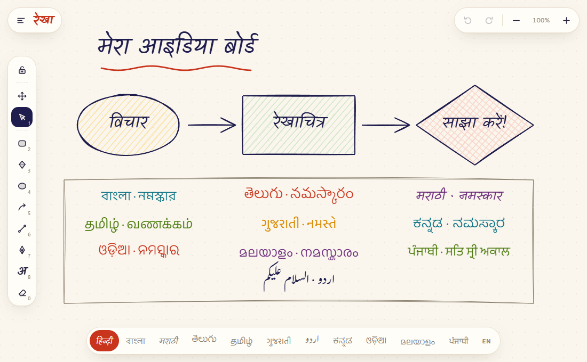
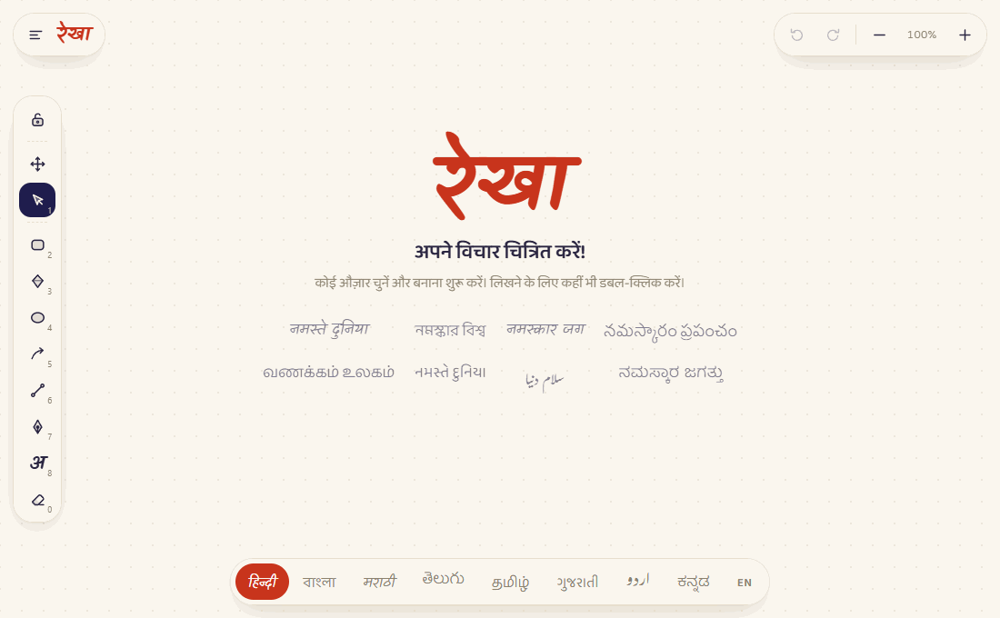
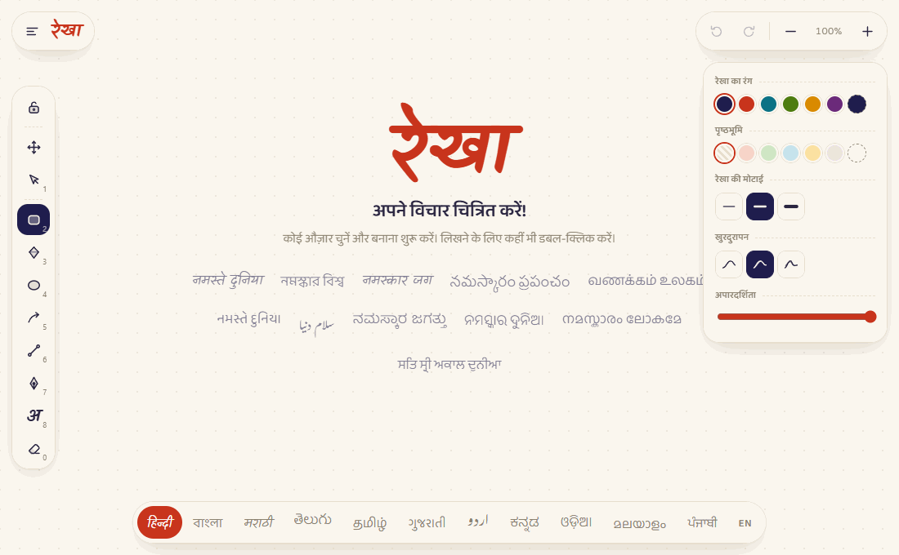
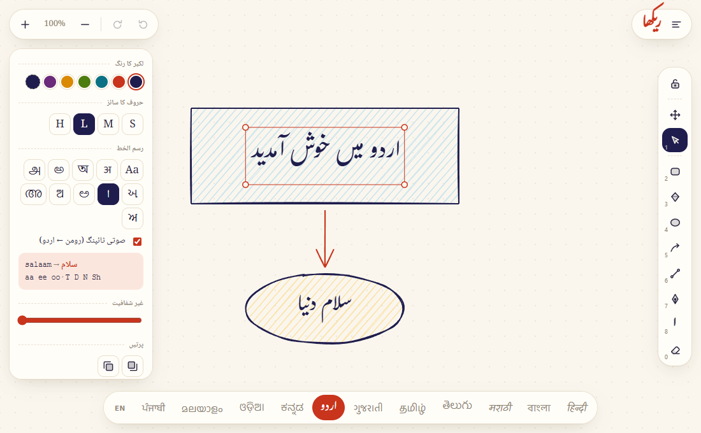
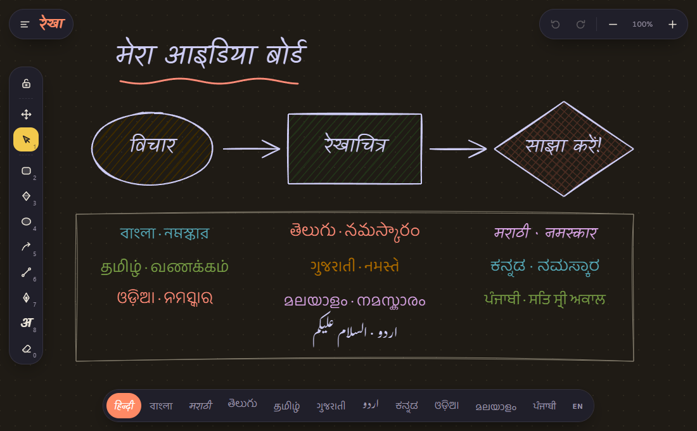
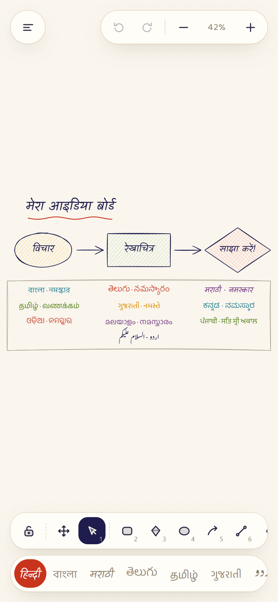

<div align="center">

# रेखा · Rekha Board

**A hand-drawn whiteboard that speaks India's languages.**

Sketch diagrams, flowcharts and notes in Hindi, Bengali, Marathi, Telugu, Tamil, Gujarati, Urdu, Kannada, Odia, Malayalam and Punjabi,
with a fully translated interface and Roman-to-script typing built in.

हिन्दी · বাংলা · मराठी · తెలుగు · தமிழ் · ગુજરાતી · اردو · ಕನ್ನಡ · ଓଡ଼ିଆ · മലയാളം · ਪੰਜਾਬੀ · English

### [▶ Try it live](https://swaroopdiwakar007.github.io/rekha-board/)



</div>

---

## Why Rekha?

*Rekha* (रेखा) means **"line"** in Hindi, Marathi, Bengali and Gujarati, and it's the first thing you draw on a whiteboard.

Most whiteboard tools treat Indian scripts as an afterthought: the menus are English-only, the handwriting fonts don't have the glyphs, and typing in your own script means installing a keyboard layout. Rekha is built the other way round:

- **The whole interface is translated.** Tool names, style options, menus and hints appear in the language you pick.
- **Every script gets its own handwriting-style font,** so your text sits naturally next to the sketchy shapes.
- **You can type phonetically on any keyboard.** Write `namaste` and get नमस्ते, with no input method to install.

The eleven languages are India's most widely spoken (Census 2011), spoken by over 90% of Indians.

---

## ✏️ Draw

Rectangles, diamonds, ellipses, arrows, lines and a freehand pen, all rendered with a hand-drawn wobble by [rough.js](https://roughjs.com). Fill shapes with hatching, cross-hatching or solid colour, and choose how rough you want the lines: *architect*, *artist* or *cartoonist*.



## ⌨️ Type in your script, from any keyboard

Turn on **phonetic typing** in the style card and type in Roman letters. Each word is converted as you type, and Backspace removes one Roman letter at a time.


| Script | You type | You get |
| --- | --- | --- |
| Devanagari (Hindi, Marathi) | `namaste` · `maraaThee` | नमस्ते · मराठी |
| Bengali | `namaskaar` | নমস্কার |
| Telugu | `telugu` | తెలుగు |
| Tamil | `vaNakkam` · `thamizh` | வணக்கம் · தமிழ் |
| Gujarati | `gujaraatee` | ગુજરાતી |
| Urdu | `salaam` · `kyaa` | سلام · کیا |
| Kannada | `kannaDa` · `bas^` | ಕನ್ನಡ · ಬಸ್ |
| Odia | `namaskaar` · `priya` | ନମସ୍କାର · ପ୍ରିୟ |
| Malayalam | `malayaaLam` · `avan` | മലയാളം · അവൻ |
| Punjabi (Gurmukhi) | `panjaabee` · `pakkaa` | ਪੰਜਾਬੀ · ਪੱਕਾ |

Prefer your own keyboard or IME? Untick phonetic typing and type normally. Pasted text is never converted.

<details>
<summary><b>Full phonetic cheat-sheet</b></summary>

| Sound | Keys | Example |
| --- | --- | --- |
| Long vowels | `aa` `ee`/`ii` `oo`/`uu` | `raam` → राम |
| Diphthongs | `ai` `au` | `kaisaa` → कैसा |
| Retroflex | `T` `Th` `D` `Dh` `N` | `ghaDee` → घडी |
| Sibilants | `sh` (श) · `Sh` (ष) · `s` (स) | `ShaTkoN` → षट्कोण |
| Aspirates | `kh` `gh` `chh` `jh` `th` `dh` `ph` `bh` | `bhaarat` → भारत |
| Anusvara · visarga · chandrabindu | `M` · `H` · `~` | `hiMdee` → हिंदी |
| Halant (kill the vowel) | `^` | `p^` → ಪ್ |
| Conjuncts | just type consonants together | `stree` → स्त्री |
| Danda | `\|` · `\|\|` | । · ॥ |
| Tamil, Telugu, Kannada, Malayalam | `e`/`o` short, `E`/`O` long | `telugu` → తెలుగు |
| Tamil and Malayalam | `zh` (ழ / ഴ) · `R` (ற / റ); Tamil also `nn` (ன) | `thamizh` → தமிழ் |
| Malayalam word endings | final `n` `N` `l` `L` `r` become chillu letters, final `m` becomes ം | `avan` → അവൻ |
| Punjabi | doubled consonants get an addak, `n` before a consonant gets a tippi | `pakkaa` → ਪੱਕਾ |
| Urdu | `kh` (خ) · `Kh` (کھ) · `N` (ں) · `R` (ڑ) | `?` → ؟ |

Letters are case-sensitive: `t` is त but `T` is ट.
</details>

## 🌐 Twelve languages, one click

The **script ribbon** at the bottom switches the entire interface. Each language's button is written in its own script, and the app name changes with it: रेखा, রেখা, రేఖ, கோடு, રેખા, ریکھا, ರೇಖೆ, ରେଖା, രേഖ, ਰੇਖਾ.



### Right-to-left for Urdu

Choosing اردو mirrors the whole layout: the tool rail, style card and menus all move to the opposite side, and text is set in the Nastaliq-style Gulzar font.



## 🌙 Dark mode & 📱 phones

<table>
<tr>
<td width="62%"></td>
<td width="38%"></td>
</tr>
<tr>
<td align="center">Dark mode keeps your colours readable</td>
<td align="center">On phones, the tools move to the bottom</td>
</tr>
</table>

---

## Features at a glance

- **Shapes:** rectangle, diamond, ellipse, arrow, line, freehand pen, eraser
- **Style:** six ink colours plus a custom picker, six fill colours, hatch / cross-hatch / solid fills, three stroke widths, three roughness levels, opacity
- **Text:** four sizes, a choice of eleven scripts per text box, multi-line, and auto-sizing
- **Editing:** select, marquee-select, move, resize from the corners (Shift keeps proportions), duplicate, Alt-drag to copy, bring to front / send to back, copy / cut / paste, arrow-key nudge
- **Canvas:** infinite pan and zoom (10%–3000%), dot grid, undo / redo
- **Files:** export **PNG** (2× resolution) or **SVG** (fonts linked), save and reopen `.rekha.json` drawings, automatic saving in your browser
- **No build step and no dependencies to install.** It's plain HTML, CSS and JavaScript.

## Getting started

```bash
git clone https://github.com/swaroopdiwakar007/rekha-board.git
cd rekha-board
python -m http.server 5180
```

Open **http://localhost:5180**. Any static file server works (`npx serve`, VS Code Live Server, GitHub Pages…). Fonts and rough.js load from CDNs, so you'll need an internet connection.

## Keyboard shortcuts

| Key | Tool | | Key | Action |
| --- | --- | --- | --- | --- |
| `1` `V` | Select | | `Ctrl` `Z` / `Ctrl` `Shift` `Z` | Undo / redo |
| `H`, or hold `Space` | Pan | | `Ctrl` `D` | Duplicate |
| `2` `R` | Rectangle | | `Ctrl` `C` / `X` / `V` | Copy / cut / paste |
| `3` `D` | Diamond | | `Delete` | Delete selection |
| `4` `O` | Ellipse | | `Ctrl` + scroll | Zoom |
| `5` `A` | Arrow | | `Ctrl` `0` | Reset zoom |
| `6` `L` | Line | | `Ctrl` `S` / `Ctrl` `O` | Save / open file |
| `7` `P` | Pen | | `Enter` | Edit selected text |
| `8` `T` | Text (or double-click) | | `Esc` / `Ctrl` `Enter` | Finish editing |
| `0` `E` | Eraser | | `Q` | Keep the current tool active |

## How it works

| File | What it does |
| --- | --- |
| [`index.html`](index.html) | Page shell: canvas, tool rail, style card, script ribbon |
| [`styles.css`](styles.css) | Paper-and-ink theme, dark mode, RTL-aware layout (logical CSS properties) |
| [`app.js`](app.js) | Canvas engine: element model, hit-testing, selection and resize, history, persistence, PNG and SVG export |
| [`i18n.js`](i18n.js) | Translated UI strings, plus the table of scripts, fonts and line heights |
| [`translit.js`](translit.js) | Roman-to-Indic transliteration |

**The transliteration trick:** Unicode lays out the Brahmic scripts in parallel blocks, so क (U+0915), ক (U+0995), ਕ (U+0A15), ક (U+0A95), କ (U+0B15), க (U+0B95), క (U+0C15), ಕ (U+0C95) and ക (U+0D15) sit at the same offset in their blocks. `translit.js` converts Roman input to Devanagari once and then shifts each code point into the target script's block. It then patches each script's gaps: Tamil merges aspirated and voiced consonants and uses an explicit pulli, Bengali has no separate व, Dravidian scripts distinguish short and long e and o, Malayalam ends words with chillu letters, Gurmukhi uses tippi and addak instead of most conjuncts, and Odia writes standalone य as ୟ. Urdu is an abjad, so it has its own position-aware mapping in which short vowels drop out mid-word.

**Fonts:** [Kalam](https://fonts.google.com/specimen/Kalam) (Latin and Devanagari), the [Baloo 2](https://fonts.google.com/specimen/Baloo+2) family (Bengali, Telugu, Tamil, Gujarati, Kannada, Odia, Malayalam, Gurmukhi) and [Gulzar](https://fonts.google.com/specimen/Gulzar) (Urdu), all from Google Fonts.

## Credits

- [rough.js](https://roughjs.com) by Preet Shihn, for the hand-drawn rendering
- Fonts by their designers via Google Fonts: Kalam (Indian Type Foundry), Baloo (Ek Type), Gulzar (Borna Izadpanah, Fiona Ross, Simon Cozens)
